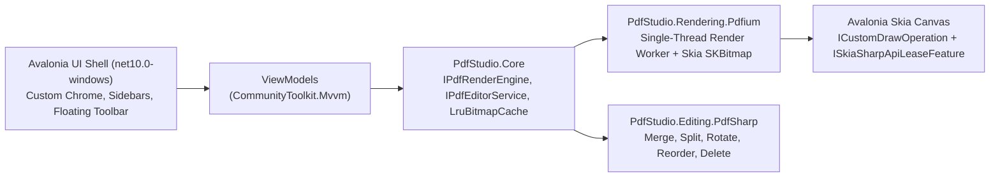

# Implementation Plan — Native Windows PDF Studio (`.NET 10` + Avalonia UI)

## Goal Description

Build a fast, native-feeling Windows desktop PDF viewer and structural editor targeting **`.NET 10` (`net10.0-windows`)** using **Avalonia UI 11.x (Skia-rendered)**, native **PDFium** bindings for hardware-accelerated page rasterization, and **`PdfSharpCore`** for lossless structural PDF editing (merge, split, extract, reorder, rotate, delete, insert blank pages, metadata edits).

The visual layer implements the Linear/Figma-inspired design system specified in [`DESIGN.md`](./DESIGN.md).

---

## User Review Required

> [!IMPORTANT]
> **Key Architecture Choice — PDFium Integration Strategy**
> Three viable PDFium options exist on `net10.0-windows`:
> 1. **Direct native `pdfium.dll` P/Invoke (`LibraryImport`) + `SkiaSharp`** *(Recommended)*: Bundles `win-x64` `pdfium.dll` (via `bblanchon/pdfium-binaries` or NuGet native package), keeps `FPDF_DOCUMENT` open in memory, and renders via `FPDFBitmap_CreateEx` directly into an `SKBitmap` pixel buffer (`BGRA8888`) with zero intermediate PNG/byte-array copies. Also unlocks `FPDFText_*` (text search/selection) and `FPDFBookmark_*` (outline tree).
> 2. **`PDFtoImage` NuGet**: Fast bootstrap (`Conversion.ToImage` returns `SKBitmap` directly via bundled PDFium), zero P/Invoke boilerplate. Trade-off: re-opens/parses the PDF stream per call unless managed carefully, and does not expose text selection or bookmark APIs out of the box.
> 3. **`PdfiumViewer.Updated`**: Built around `System.Drawing.Common` / GDI+ (`Bitmap`), which adds unnecessary Windows GDI+ -> Skia conversion overhead in an Avalonia Skia app.
>
> **Recommendation:** Abstract all rendering behind `IPdfRenderEngine` in `PdfStudio.Core`. Implement `PdfiumRenderEngine` using `.NET` `[LibraryImport]` P/Invoke directly against `pdfium.dll` (with `PDFtoImage` noted as a zero-boilerplate fallback if you prefer faster Phase 1 bring-up without text-selection yet). Please confirm if you prefer **Direct `pdfium.dll` P/Invoke** or **`PDFtoImage` first**.

> [!WARNING]
> **PDFium Threading & Windows File-Lock Constraints**
> - **Single-Thread Affinity:** Native PDFium is **not thread-safe**. All `FPDF_*` calls must run on a single serialized worker thread backed by a prioritized `Channel<RenderRequest>` (Visible Viewport > Adjacent Preload > Thumbnails).
> - **File Locking on Save:** Opening a file directly from disk can lock it on Windows while `PdfSharpCore` tries to overwrite it. We will load PDFium documents from an in-memory buffer / stream (or copy-on-open for large files) and perform **atomic temp-file + `File.Replace` saves** via `PdfSharpCore`, then hot-reload the PDFium session and flush the LRU bitmap cache.

---

## System Architecture



### NuGet Dependencies (Verified for `.NET 10` / `net10.0-windows`)
- **UI & Fonts:** `Avalonia` (`11.x`), `Avalonia.Desktop`, `Avalonia.Themes.Fluent`, `Avalonia.Skia`, `Avalonia.Fonts.Inter`, `Avalonia.Controls.DataGrid` (if needed), `CommunityToolkit.Mvvm`
- **Rendering:** `SkiaSharp` + native `pdfium.dll` (`win-x64` via `bblanchon/pdfium-binaries` or `PDFtoImage` for managed PDFium distribution)
- **Structural Editing:** `PdfSharpCore` + `System.Text.Encoding.CodePages`
- **DI & Logging:** `Microsoft.Extensions.DependencyInjection`, `Microsoft.Extensions.Logging`
- **Testing:** `xunit`, `Avalonia.Headless.XUnit`, `FluentAssertions`

---

## Proposed Solution Structure

```text
PdfStudio.slnx
├── Directory.Build.props                 # net10.0-windows, Nullable=enable, ImplicitUsings=enable, LangVersion=latest
├── src/
│   ├── PdfStudio.Core/                   # Domain models, interfaces, LRU bitmap cache, undo/redo command stack
│   │   ├── Documents/
│   │   │   ├── PdfDocumentSession.cs     # Active file path, dirty state, page metadata, structural state
│   │   │   ├── PdfPageInfo.cs            # Page index, width/height in pt, rotation, label
│   │   │   └── PdfOutlineNode.cs         # Bookmark / TOC tree node
│   │   ├── Rendering/
│   │   │   ├── IPdfRenderEngine.cs       # Open, Close, GetPageSizes, GetOutline, RenderPageAsync, CancelPending
│   │   │   ├── RenderRequest.cs          # PageIndex, Scale/DPI, Priority, CancellationToken
│   │   │   └── LruBitmapCache.cs         # Memory-bounded SKBitmap cache with deterministic Dispose()
│   │   └── Editing/
│   │       ├── IPdfEditorService.cs      # Merge, Split, Extract, Rotate, Delete, Reorder, InsertBlank, Save
│   │       └── StructuralEditPlan.cs     # Pending non-destructive structural operations before Save
│   ├── PdfStudio.Rendering.Pdfium/       # Native PDFium P/Invoke (LibraryImport) + single-threaded worker
│   │   ├── Interop/
│   │   │   ├── PdfiumNative.cs           # FPDF_InitLibrary, FPDF_LoadMemDocument, FPDFBitmap_CreateEx, FPDF_RenderPageBitmap
│   │   │   └── SafePdfHandles.cs         # SafeHandle wrappers for FPDF_DOCUMENT, FPDF_PAGE, FPDF_BITMAP
│   │   ├── PdfiumWorker.cs               # Dedicated single-thread Channel<T> scheduler with priority queue
│   │   └── PdfiumRenderEngine.cs         # IPdfRenderEngine implementation outputting SKBitmap (BGRA8888)
│   ├── PdfStudio.Editing.PdfSharp/       # PdfSharpCore structural PDF operations
│   │   ├── PdfSharpEditorService.cs      # Atomic save, merge, split, rotate, reorder, extract, metadata
│   │   └── EncodingBootstrap.cs          # Registers CodePagesEncodingProvider.Instance once at startup
│   └── PdfStudio.App/                    # Avalonia UI desktop app (net10.0-windows)
│       ├── Assets/
│       │   ├── Fonts/                    # JetBrainsMono-*.ttf
│       │   └── Icons/                    # 1.5px stroke StreamGeometry icon dictionary
│       ├── Themes/
│       │   ├── DesignTokens.axaml        # Dark (#0F1115...) & Light ThemeDictionaries, spacing, radii
│       │   ├── Typography.axaml          # Inter & JetBrains Mono + tnum OpenType FontFeatures
│       │   ├── Motion.axaml              # 160ms SplineEasing (0.16, 1, 0.3, 1) styles & transitions
│       │   └── Controls.axaml            # Linear/Figma ghost buttons, segmented pills, inputs, scrollbars
│       ├── Controls/
│       │   ├── PdfCanvasControl.cs       # High-DPI pan/zoom viewport + ICustomDrawOperation (Skia)
│       │   ├── SkiaBitmapDrawOp.cs       # Leases ISkiaSharpApiLeaseFeature -> SKCanvas.DrawBitmap
│       │   └── FloatingToolbar.axaml     # Elevated #1E222B floating pill toolbar
│       ├── ViewModels/
│       │   ├── MainWindowViewModel.cs
│       │   ├── CanvasViewModel.cs        # Zoom, pan, page navigation, fit modes, coordinate tracking
│       │   ├── ThumbnailSidebarViewModel.cs
│       │   ├── InspectorViewModel.cs     # Page dimensions, metadata, structural editing actions
│       │   └── CommandPaletteViewModel.cs
│       ├── Views/
│       │   ├── MainWindow.axaml          # Custom 36px Windows chrome + 3-pane layout + modal overlay host
│       │   ├── ThumbnailSidebarView.axaml
│       │   ├── InspectorPanelView.axaml
│       │   └── Dialogs/                  # Merge/Split/Extract modal dialogs with 160ms scale+fade entry
│       ├── App.axaml
│       └── Program.cs
└── tests/
    └── PdfStudio.Tests/                  # xUnit + Avalonia.Headless.XUnit tests
```

---

## Implementation Phases

### Phase 1 — Solution Scaffolding & Design System (`DESIGN.md`)
1. Create `PdfStudio.slnx`, `Directory.Build.props` (`TargetFramework=net10.0-windows`, `UseWPF=false`, `EnableWindowsTargeting=true`, `PublishReadyToRun` ready), and project files.
2. Embed `JetBrains Mono` font files and configure `Avalonia.Fonts.Inter`.
3. Implement `Themes/DesignTokens.axaml`, `Typography.axaml` (with `FontFeature Tag="tnum" Value="1"`), `Motion.axaml` (`SplineEasing X1="0.16" Y1="1" X2="0.3" Y2="1"` at `0:0:0.16`), and `Icons.axaml` (`1.5px` stroke `StreamGeometry` paths).
4. Build the shell `MainWindow.axaml` with Windows custom client area chrome (`36px` title bar), collapsible left/right sidebars (`160ms` GPU-composited `TranslateTransform` + `Opacity`), and floating bottom toolbar.

### Phase 2 — Native PDFium Rendering Engine & Skia Viewport
1. Implement `PdfiumNative.cs` (`[LibraryImport("pdfium")]`) and `SafeHandle` wrappers for deterministic native cleanup.
2. Implement `PdfiumWorker` using a dedicated `Thread` (`IsBackground = true`, `Priority = AboveNormal`) draining a prioritized request queue so visible viewport pages preempt off-screen thumbnails, and stale zoom requests are cancelled cleanly.
3. Render directly into `SKBitmap` (`SKColorType.Bgra8888`, `SKAlphaType.Premul`) via `FPDFBitmap_CreateEx(..., bitmap.GetPixels(), bitmap.RowBytes)` to avoid extra pixel copies.
4. Implement `LruBitmapCache` (configurable byte budget, e.g., `512 MB` default, disposing evicted `SKBitmap`s on the UI-safe disposal path after the current Skia frame completes).
5. Build `PdfCanvasControl` with:
   - `ICustomDrawOperation` leasing `ISkiaSharpApiLeaseFeature` (`SKCanvas.DrawBitmap` with `SKSamplingOptions` cubic/linear filtering and subtle page drop shadow).
   - Smooth zoom-to-cursor (`Ctrl + Wheel`), drag-to-pan (`Space + Drag` or Hand tool), `Fit Width`, `Fit Page`, and live cursor PDF-point coordinate readout (`X / Y pt` in `JetBrains Mono`).
   - Virtualized page layout calculation supporting variable page sizes and per-page rotation previews.

### Phase 3 — Structural PDF Editing (`PdfSharpCore`)
1. Register `Encoding.RegisterProvider(CodePagesEncodingProvider.Instance)` at startup.
2. Implement `PdfSharpEditorService` supporting:
   - **Rotate Pages** (`0° / 90° / 180° / 270°` CW/CCW on selected pages)
   - **Reorder Pages** (drag-and-drop or move up/down in thumbnail rail)
   - **Delete Pages** (with undoable `StructuralEditPlan` before committing to disk)
   - **Insert Blank Page** (matching current page size or A4/Letter)
   - **Extract / Split Pages** (range syntax e.g. `1-3, 5, 8-10` or split-every-N-pages into a folder)
   - **Merge PDFs** (multi-file modal queue with drag-to-reorder)
3. Implement **Non-Destructive Staged Edits + Atomic Save**:
   - Rotating/reordering/deleting updates the in-memory `StructuralEditPlan` immediately (giving instant visual feedback in the thumbnail rail and canvas without rewriting the PDF on every click) and marks the document dirty (`WarningBrush` dot in the `36px` title bar).
   - `Ctrl+S` / `Save As` commits all staged structural changes via `PdfSharpCore` to a `.tmp` file beside the target, atomically replaces the target (`File.Replace`), and reloads the `PdfiumRenderEngine` session cleanly.

### Phase 4 — Productivity Polish & Windows Integration
1. **Command Palette (`Ctrl+K`):** Quick-jump to page, zoom presets, theme toggle (`Dark` / `Light`), structural actions, and recent files.
2. **Windows Native Ergonomics:** File drag-and-drop onto window, command-line file argument opening (`PdfStudio.exe "path.pdf"`), DPI scale awareness (`VisualRoot.RenderScaling`), and keyboard shortcuts (`Ctrl+O`, `Ctrl+S`, `Ctrl+Shift+S`, `Ctrl+0`, `Ctrl+1`, `Ctrl+=`/`-`, `[` / `]` sidebar toggles).
3. **Graceful Error Handling:** Password-protected PDF prompt modal (`FPDF_LoadMemDocument` password callback + `PdfSharpCore` password handling) and corrupted PDF toast banners.

---

## Verification Plan

### Automated Tests (`tests/PdfStudio.Tests`)
1. **`LruBitmapCacheTests`**: Verify byte-budget eviction, hit promotion, and deterministic `Dispose()` of evicted `SKBitmap` instances.
2. **`PdfSharpEditorServiceTests`**: Generate synthetic multi-page fixture PDFs in test setup and verify:
   - Merge combines expected page counts and dimensions.
   - Split/Extract outputs valid PDFs for ranges (`1-2,4`) and rejects invalid ranges.
   - Rotate (`+90°`, `-90°`, `180°`), Reorder, Delete, and Insert Blank preserve page integrity and save atomically without leaving `.tmp` files.
3. **`PdfiumRenderEngineTests`**: Open fixture PDFs, verify `PageCount`, `PageSize` (points), and non-empty `SKBitmap` rasterization (`Width`, `Height`, non-zero pixel variance) across `96` and `192` DPI, plus safe concurrent cancellation.
4. **`MainWindowHeadlessTests` (`Avalonia.Headless.XUnit`)**: Verify Dark/Light `ThemeVariant` switching resolves all design tokens, sidebar toggle commands update state, and zoom/page commands clamp bounds properly.

Run command (once implemented):
```powershell
dotnet test PdfStudio.slnx --configuration Release
```

### Manual Verification Checklist (Windows Desktop)
- [ ] Launch on Windows at `100%` and `150%` DPI scaling; verify `1px` hairline borders (`#282D38` Dark / `#E5E7EB` Light) and `1.5px` stroke icons are crisp without blur.
- [ ] Toggle Dark <-> Light theme live; verify instant switch with zero unstyled controls.
- [ ] Open a 100+ page PDF; verify rapid scrolling and `Ctrl + Wheel` zoom stay responsive with no UI thread stalls and bounded memory.
- [ ] Verify `JetBrains Mono` tabular numerals keep the zoom pill (`95%` -> `100%`) and page counter (`9 / 120` -> `10 / 120`) completely stationary without horizontal jitter.
- [ ] Verify `160ms` `(0.16, 1, 0.3, 1)` transitions on sidebar collapse, hover states, and modal overlays.
- [ ] Rotate, reorder, delete a page, save (`Ctrl+S`), reopen the saved PDF in another viewer (e.g., Edge/Chrome), and confirm structural changes persisted cleanly.

